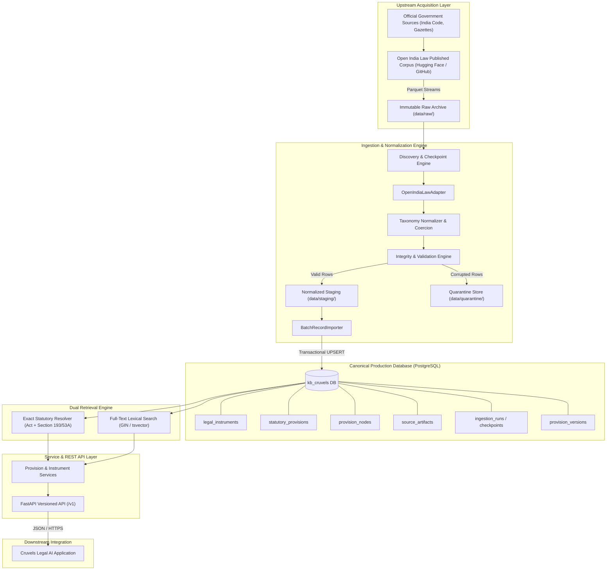

# Knowledge Base Cruvels - System Architecture

**Document Version:** 1.0.0  
**Status:** Canonical & Active

---

## 1. Executive Summary & Architectural Philosophy

**Knowledge Base Cruvels** is a standalone, production-oriented Indian Legal Knowledge Platform designed to acquire, normalize, validate, index, and serve the primary statutory law of India (Central, State, Union Territory enactments, and subordinate regulations).

### Core Principles
1. **Verbatim Content Preservation**: Statutory wording is always ingested directly from authentic source material and stored in full text. **Zero artificial synthesis or hallucination**.
2. **Deterministic & Idempotent**: All legal instruments and provisions have deterministic, content-addressable identifiers. Ingestion can be repeated without data duplication or state drift.
3. **Decoupled Autonomous Subsystem**: Built as an independent data product with its own PostgreSQL database, streaming ingestion, verification subsystem, and versioned REST API (`/v1`). It is designed to be consumed downstream by Cruvels Legal AI through an explicit versioned contract.
4. **Resumable Memory-Efficient Pipeline**: Handles tens of gigabytes of Parquet/JSONL data without exhausting system memory by utilizing PyArrow RecordBatch streaming and persistent multi-layer checkpointing.

---

## 2. High-Level Architecture & Component Map

---

## 3. Storage & Data Lifecycle Boundaries

To prevent conceptual confusion, the platform strictly segregates three distinct tiers of data:

| Tier | Format & Location | Responsibility | Immutability |
|---|---|---|---|
| **A. Raw Source Documents** | Parquet / JSONL.gz in `data/raw/open-india-law/<snapshot>/` | Exact upstream byte archive, provenance records, and re-extraction baseline. | **Immutable** once downloaded and checksummed. |
| **B. Normalized Staging Data** | Parquet in `data/staging/<run_id>/` | Intermediate, strongly-typed domain records partitioned by run ID. | **Ephemeral & Reproducible**; can be regenerated at will. |
| **C. Canonical Production Database** | Relational tables in PostgreSQL (`kb_cruvels`) | Validated legal records served by the API, exact section lookups, and relational linkages. | **Authoritative Source of Truth** with ACID transactional guarantees. |

---

## 4. Ingestion Workflow & Resilience

The ingestion engine processes 37 legislation partitions (1 Central + 28 States + 8 UTs) and 12 regulatory partitions:

1. **Manifest Inspection**: Prior to downloading or processing, `build_source_manifest.py` verifies the snapshot identity, expected file sizes, and expected row counts.
2. **Streaming Batch Iteration**: Utilizes PyArrow's `iter_batches()` with a configurable batch size (default 1,000 rows), ensuring bounded RAM usage (< 250 MB).
3. **Deterministic ID Generation**:
   - `instrument_id`: Deterministic hash of `jurisdiction + state + normalized_title + year`.
   - `provision_id`: Deterministic hash of `instrument_id + normalized_section_number`.
4. **Validation & AST Parsing**: Verifies non-empty text, valid SHA-256 hashes, and extracts structural AST nodes (subsections, clauses, provisos) without ever inventing hierarchy.
5. **Durable Checkpointing**: Checkpoint state is recorded to disk (`data/checkpoints/`) and to the database (`ingestion_checkpoints`). Interrupted runs resume from the last committed batch without reprocessing completed files.

---

## 5. Dual Retrieval Engine

1. **Exact Statutory Resolution (`/v1/provisions/resolve`)**:
   - Matches by Act identifier (full title, short title, or source act ID) and normalized section number (e.g. `193`, `53A`, `72A`, `Article 21`, `SCH-1`).
   - High performance index on `(instrument_id, section_number_norm)`.
2. **Full-Text Lexical Search (`/v1/search`)**:
   - Multi-term keyword queries across section titles, verbatim text, chapter headings, and enactment titles.
   - Filterable by jurisdiction (e.g., `central` vs `maharashtra`) and in-force status.
