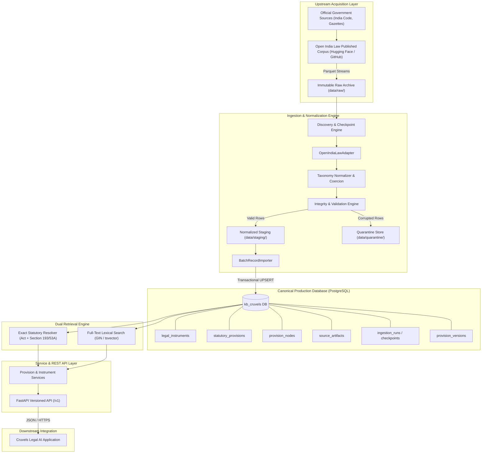
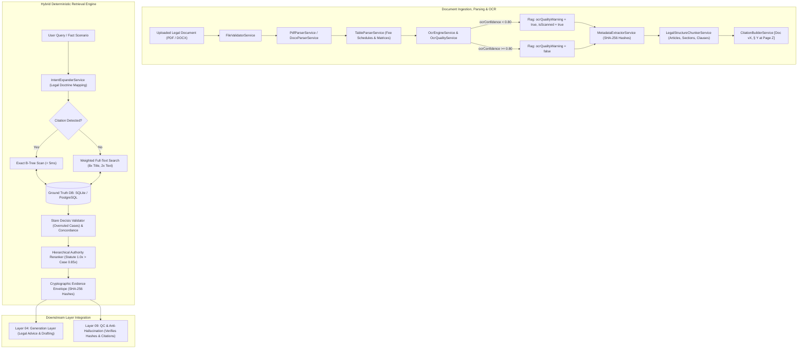

# Knowledge Base Cruvels - System Architecture

**Document Version:** 1.0.0  
**Status:** Canonical & Active

---

## 1. Executive Summary & Architectural Philosophy

**Knowledge Base Cruvels** is a standalone, production-oriented Indian Legal Knowledge Platform designed to acquire, normalize, validate, index, and serve the primary statutory law of India (Central, State, Union Territory enactments, and subordinate regulations).

### Core Principles
1. **Verbatim Content Preservation**: Statutory wording is always ingested directly from authentic source material and stored in full text. **Zero artificial synthesis or hallucination**.
2. **Deterministic & Idempotent**: All legal instruments and provisions have deterministic, content-addressable identifiers. Ingestion can be repeated without data duplication or state drift.
3. **Decoupled Autonomous Subsystem**: Built as an independent data product with its own PostgreSQL database, streaming ingestion, verification subsystem, and versioned REST API (`/v1`). It is designed to be consumed downstream by Cruvels Legal AI through an explicit versioned contract.
4. **Resumable Memory-Efficient Pipeline**: Handles tens of gigabytes of Parquet/JSONL data without exhausting system memory by utilizing PyArrow RecordBatch streaming and persistent multi-layer checkpointing.

---

## 2. High-Level Architecture & Component Map



---

## 3. Storage & Data Lifecycle Boundaries

To prevent conceptual confusion, the platform strictly segregates three distinct tiers of data:

| Tier | Format & Location | Responsibility | Immutability |
|---|---|---|---|
| **A. Raw Source Documents** | Parquet / JSONL.gz in `data/raw/open-india-law/<snapshot>/` | Exact upstream byte archive, provenance records, and re-extraction baseline. | **Immutable** once downloaded and checksummed. |
| **B. Normalized Staging Data** | Parquet in `data/staging/<run_id>/` | Intermediate, strongly-typed domain records partitioned by run ID. | **Ephemeral & Reproducible**; can be regenerated at will. |
| **C. Canonical Production Database** | Relational tables in PostgreSQL (`kb_cruvels`) | Validated legal records served by the API, exact section lookups, and relational linkages. | **Authoritative Source of Truth** with ACID transactional guarantees. |

---

## 4. Ingestion Workflow & Resilience

The ingestion engine processes 37 legislation partitions (1 Central + 28 States + 8 UTs) and 12 regulatory partitions:

1. **Manifest Inspection**: Prior to downloading or processing, `build_source_manifest.py` verifies the snapshot identity, expected file sizes, and expected row counts.
2. **Streaming Batch Iteration**: Utilizes PyArrow's `iter_batches()` with a configurable batch size (default 1,000 rows), ensuring bounded RAM usage (< 250 MB).
3. **Deterministic ID Generation**:
   - `instrument_id`: Deterministic hash of `jurisdiction + state + normalized_title + year`.
   - `provision_id`: Deterministic hash of `instrument_id + normalized_section_number`.
4. **Validation & AST Parsing**: Verifies non-empty text, valid SHA-256 hashes, and extracts structural AST nodes (subsections, clauses, provisos) without ever inventing hierarchy.
5. **Durable Checkpointing**: Checkpoint state is recorded to disk (`data/checkpoints/`) and to the database (`ingestion_checkpoints`). Interrupted runs resume from the last committed batch without reprocessing completed files.

---

## 5. Dual Retrieval Engine

1. **Exact Statutory Resolution (`/v1/provisions/resolve`)**:
   - Matches by Act identifier (full title, short title, or source act ID) and normalized section number (e.g. `193`, `53A`, `72A`, `Article 21`, `SCH-1`).
   - High performance index on `(instrument_id, section_number_norm)`.
2. **Full-Text Lexical Search (`/v1/search`)**:
   - Multi-term keyword queries across section titles, verbatim text, chapter headings, and enactment titles.
   - Filterable by jurisdiction (e.g., `central` vs `maharashtra`) and in-force status.


---

## 6. Layer 03 — Knowledge Intelligence & Legal RAG Engine

Layer 03 is the canonical **Knowledge Intelligence, Ingestion, OCR, and Deterministic Legal Retrieval Engine**. It acts as the single source of truth for citations and grounding metadata for the entire platform.



### Key Architectural Capabilities of Layer 03

1. **Document Ingestion & Multi-Format Parsing (`src/parsing/`, `src/ingestion/`)**:
   - Parses multi-page digital PDFs, DOCX legal briefs, contracts, and court order sheets.
   - Preserves exact page streams (`[Page 1]`, `[Page 2]`) and character offsets.
   - Extracts structured Markdown/grid tables (fee matrices, financial schedules, damage breakdowns).

2. **OCR Quality Gating & Scan Warning Flags (`src/ocr/`)**:
   - Evaluates scanned document legibility using `ocrConfidence` ($0.0 - 1.0$).
   - **The 0.80 Threshold Gate**: Chunks with $\text{ocrConfidence} < 0.80$ are automatically tagged with `ocrQualityWarning: true` and `isScanned: true` to prevent false hallucination flags in Layer 09.

3. **Zero-Truncation Structural Chunking (`src/chunking/`)**:
   - Chunks strictly along legal structural units (Articles, Sections, Clauses, Schedules).
   - Guarantees legal provisos and conditions are never severed mid-sentence.

4. **Cryptographic Citation Pipeline (`src/context/citation-builder.ts`)**:
   - Standardized Citation Format: `[<Document Title> v<Version>, § <Section> at Page <Page Number>]`.
   - Every chunk carries a cryptographic **SHA-256 content hash** to provide Layer 09 with tamper-proof ground truth.

5. **Multi-Category Hybrid Retrieval (`src/retrieval/`, `src/repository/`)**:
   - **Direct Lookups:** B-Tree index scan in $< 5\text{ ms}$ (e.g. Section 138 NI Act, Section 27 Contract Act).
   * **Scenario Queries:** Maps real-world fact patterns (e.g. bounced cheques, non-competes) to governing statutory sections without explicit citations.
   * **Stare Decisis Validation:** Traverses overruling graphs to attach warnings to overruled precedents (*ADM Jabalpur*).
   * **Code Concordance:** Maps legacy colonial codes to 2023 Sanhitas (IPC 420 $\rightarrow$ BNS 318, CrPC 438 $\rightarrow$ BNSS 482).

---

## 7. Manual Testing Guide & CLI Commands

Developers and lawyers can test Layer 03 manually using direct CLI tools:

### A. Manual Document Ingestion & Parsing Test
Run the interactive document ingestion tool to test parsing, table extraction, and citations:
```powershell
cd knowledge-base-cruvels/layer03

# 1. Ingest default multi-page legal contract (with Fee Table & Sections)
npx tsx src/run-ingest.ts

# 2. Ingest custom legal text directly
npx tsx src/run-ingest.ts "ARTICLE I: CONFIDENTIALITY Section 1.1 Duty of Secrecy: The recipient shall keep all technical data secret."

# 3. Ingest any physical file on disk (PDF, DOCX, TXT)
npx tsx src/run-ingest.ts path/to/document.pdf
```

### B. Manual Legal Query & Retrieval Test
Run any direct statutory lookup, fact scenario, or paraphrased question:
```powershell
cd knowledge-base-cruvels/layer03

# 1. Direct Statutory Lookup (Section 138 NI Act)
npx tsx src/run-input.ts "The Negotiable Instruments Act, 1881, Section 138"

# 2. Direct Statutory Lookup (Section 27 Contract Act)
npx tsx src/run-input.ts "The Indian Contract Act, 1872, Section 27"

# 3. Real-World Fact Scenario (Cheque Bounce)
npx tsx src/run-input.ts "A customer issued a cheque that bounced due to insufficient funds. What is the governing law?"

# 4. Paraphrased Non-Compete Question
npx tsx src/run-input.ts "Is an agreement that restrains an employee from working with competitors after leaving valid in India?"

# 5. Criminal Code Transition
npx tsx src/run-input.ts "Section 420 IPC"
```

### C. Automated Test Suites
```powershell
cd knowledge-base-cruvels/layer03

# Ingestion, OCR (<0.80 flags) and Citation Verification (11 Checks)
npx tsx tests/verify-citation-ingestion-pipeline.ts

# Comprehensive 27-Test Benchmark (Direct, Indirect, Scenario, Paraphrased, Negative)
npx tsx tests/comprehensive-retrieval-suite.ts

# Official System Benchmark (13 Suites, B-Tree scans, 50 load concurrency)
npm test
```
